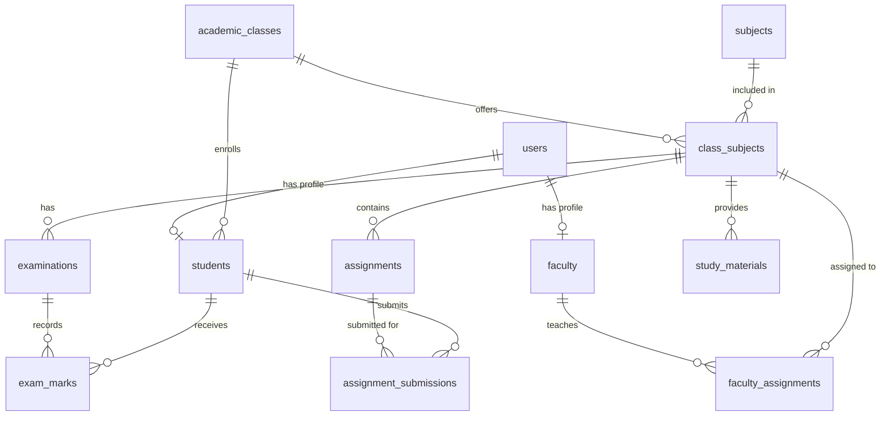

# ClassPilot – Smart Academic Management System

> **Tagline:** *Learning. Managing. Growing.*  
> **Status:** Production-Ready (Step 1, Step 2 & Step 3 Completed)

[](#8-automated-test-suite)
[](https://www.python.org/)
[](https://fastapi.tiangolo.com/)
[](https://react.dev/)
[](https://www.postgresql.org/)
[](https://www.docker.com/)

---

## 1. Project Overview

**ClassPilot** is an enterprise-grade academic management system engineered to modernize institutional operations, student-faculty academic workflows, examination lifecycle management, course content distribution, and role-based permissions.

### Roadmap & Completion Status

| Milestone | Status | Description |
|---|---|---|
| **Step 1: Foundation & Authentication** | ✅ Complete | PostgreSQL database foundation, Alembic migrations, stateless JWT authentication, bcrypt password hashing, role-based route guards, student and faculty portals. |
| **Step 2: Complete Academic Management** | ✅ Complete | Academic structure (Classes, Subjects, Mappings), Student enrollments, Faculty assignments, Examination schedules & marks entry, Assignments & submissions with file uploads, and Study Materials repository. |
| **Step 3: GitHub & Production Deployment** | ✅ Complete | Production Dockerization (multi-stage React build + Nginx, Python slim FastAPI), Docker Compose orchestrator, Cloud PostgreSQL URI resilience, CORS handling, strict `.gitignore` audit, zero-secret environment templates, and comprehensive documentation. |

---

## 2. Core Modules & Capabilities

### 🔐 Authentication & Role-Based Access Control (RBAC)
- **Dual Login Identifiers:**
  - Students authenticate using **Roll Number** + password.
  - Faculty authenticate using **Employee ID** or **Email** + password.
- **Cryptographic Security:** Passwords hashed with standard `bcrypt`. Cryptographically signed JWT access tokens with configurable expiration.
- **Strict Authorization:** All backend APIs enforce role scopes (`STUDENT` vs `FACULTY`). Frontend utilizes layout-level `ProtectedRoute` wrappers that isolate portals and prevent cross-role URL navigation.

### 🏫 Academic Structure & Student Directory
- **Configurable Classes & Subjects:** Classes (e.g., Class 8, Class 9, Class 10) with multi-subject mappings (Math, Science, English, Computer Science, Social Studies).
- **Class Enrollment:** Each student is enrolled in exactly one class and only sees curriculum and resources belonging to that class.
- **Faculty Teaching Assignments:** Faculty members are assigned to specific class-subject pairs and can view only students enrolled in their assigned classes.
- **Student Search:** Real-time search directory for faculty by roll number or name with class filtering.

### 📝 Examination & Marks Lifecycle
- **Exam Scheduling:** Faculty create exams for assigned class-subject combinations (Unit Tests, Mid-Terms, Finals) with defined date and maximum marks.
- **Marks Entry & Validation:** Faculty record marks for enrolled students with built-in validation preventing scores above maximum marks.
- **Grade & Percentage Computation:** Automatic percentage calculation and academic grading (A+, A, B, C, F).
- **Result Publishing Toggle:** Exam results remain confidential until faculty explicitly toggles "Published". Students only see published marks.

### 📂 Assignments & Submissions
- **Assignment Distribution:** Faculty publish homework/projects with deadlines, descriptions, and reference attachments.
- **Student Submissions:** Students submit work with notes and file attachments (PDF, DOCX, TXT, PNG, JPG).
- **Evaluation & Feedback:** Faculty review student submissions, assign scores, and provide qualitative feedback.

### 📚 Study Materials Repository
- **Courseware Distribution:** Faculty upload lecture notes, slide decks, lab manuals, and syllabus guides categorized by class and subject.
- **Instant Student Downloads:** Students filter study resources by subject and download files directly.

---

## 3. Technology Stack

### Frontend
- **Framework:** React 19 (JavaScript ES modules)
- **Tooling:** Vite 8 (Ultra-fast HMR and optimized production bundling)
- **Styling:** Tailwind CSS (Navy / Indigo institutional design system)
- **Routing:** React Router DOM (v7)
- **Icons:** Lucide React
- **API Client:** Axios with JWT request/response interceptors

### Backend
- **Framework:** FastAPI (Python 3.12)
- **ORM:** SQLAlchemy 2.0 (Declarative Base, relationship cascades, connection pooling)
- **Data Validation & Settings:** Pydantic v2 & Pydantic-Settings
- **Database Driver:** Psycopg2-binary
- **Security:** PyJWT & Passlib (Bcrypt)
- **Migrations:** Alembic
- **Testing:** Pytest & FastAPI TestClient (HTTPX)

### Infrastructure & Deployment
- **Database:** PostgreSQL 16 (Docker) / PostgreSQL 18 (Local) / Cloud DB (Neon, Supabase, Render)
- **Web Server:** Nginx Alpine (production SPA routing, gzip compression, asset caching)
- **Containerization:** Docker & Docker Compose

---

## 4. System Architecture

```
ClassPilot/
├── .env.example                       # Root / Docker environment template
├── .gitignore                         # Security & clean repository rules
├── docker-compose.yml                 # Multi-container orchestrator (DB, API, Web)
├── README.md                          # Full project documentation
├── start-backend.ps1                  # Windows PowerShell backend launcher
├── start-frontend.ps1                 # Windows PowerShell frontend launcher
│
├── backend/
│   ├── Dockerfile                     # Python 3.12-slim production container
│   ├── requirements.txt               # Backend dependencies
│   ├── alembic.ini                    # Alembic migration configuration
│   ├── seed.py                        # Idempotent academic & demo database seeder
│   ├── .env.example                   # Backend environment template
│   ├── alembic/                       # Migration versions and environment
│   │   ├── versions/
│   │   │   ├── 001_initial_users.py
│   │   │   └── 002_academic_management.py
│   │   └── env.py
│   ├── app/
│   │   ├── main.py                    # FastAPI application initialization & routers
│   │   ├── database.py                # Database engine, SessionLocal, pooling
│   │   ├── core/
│   │   │   ├── config.py              # Pydantic BaseSettings & URI normalizer
│   │   │   ├── deps.py                # Auth & RBAC dependency injectors
│   │   │   └── security.py            # Bcrypt hashing & JWT token services
│   │   ├── models/                    # SQLAlchemy database models
│   │   │   ├── __init__.py
│   │   │   ├── user.py                # User, Student, Faculty models
│   │   │   └── academic.py            # Classes, Subjects, Exams, Assignments, Materials
│   │   ├── schemas/                   # Pydantic v2 validation schemas
│   │   │   ├── __init__.py
│   │   │   ├── user.py
│   │   │   └── academic.py
│   │   ├── routers/                   # API endpoint routers
│   │   │   ├── __init__.py
│   │   │   ├── auth.py                # /auth/login, /auth/me, /auth/logout
│   │   │   ├── student.py             # /student/profile
│   │   │   ├── faculty.py             # /faculty/profile
│   │   │   ├── academic.py            # /academic/* (classes, subjects, students)
│   │   │   ├── exams.py               # /exams/* (schedules, marks, publishing)
│   │   │   └── assignments.py         # /assignments/* & /study-materials/*
│   │   ├── services/
│   │   │   ├── __init__.py
│   │   │   ├── auth_service.py
│   │   │   └── academic_service.py    # Business logic & file upload handlers
│   │   └── utils/
│   ├── tests/                         # Pytest automated test suite (36 tests)
│   │   ├── conftest.py
│   │   ├── test_auth.py
│   │   ├── test_health.py
│   │   ├── test_rbac.py
│   │   ├── test_academic.py
│   │   ├── test_exams.py
│   │   └── test_assignments.py
│   └── uploads/                       # User upload storage
│       ├── assignments/
│       ├── submissions/
│       └── materials/
│
└── frontend/
    ├── Dockerfile                     # Multi-stage build (Node -> Nginx)
    ├── nginx.conf                     # Nginx SPA fallback & gzip config
    ├── package.json                   # React 19 dependencies & scripts
    ├── vite.config.js                 # Vite build settings
    ├── tailwind.config.js             # Styling configuration
    ├── .env.example                   # Frontend environment template
    ├── public/
    └── src/
        ├── App.jsx                    # Root app component
        ├── main.jsx                   # React DOM entry
        ├── components/
        │   ├── Navbar.jsx             # Top bar with profile and logout
        │   ├── Sidebar.jsx            # Dynamic navigation menu
        │   └── ProtectedRoute.jsx     # Route-level RBAC shield
        ├── layouts/
        │   └── DashboardLayout.jsx    # Responsive sidebar layout
        ├── context/
        │   └── AuthContext.jsx        # JWT authentication context
        ├── hooks/
        │   └── useAuth.js
        ├── routes/
        │   └── AppRoutes.jsx          # Route mappings & redirects
        ├── services/
        │   ├── api.js                 # Axios client with bearer token
        │   ├── authService.js         # Login & user session API
        │   └── academicService.js     # Academic, Exam, Assignment, Material APIs
        └── pages/
            ├── UnauthorizedPage.jsx   # 403 screen
            ├── NotFoundPage.jsx       # 404 screen
            ├── auth/
            │   └── LoginPage.jsx      # Dual role toggle & demo quick-fill
            ├── student/
            │   ├── StudentDashboard.jsx
            │   ├── MyClassPage.jsx
            │   ├── ExamsPage.jsx
            │   ├── ResultsPage.jsx
            │   ├── AssignmentsPage.jsx
            │   └── StudyMaterialsPage.jsx
            └── faculty/
                ├── FacultyDashboard.jsx
                ├── MyClassesPage.jsx
                ├── StudentManagementPage.jsx
                ├── ExamsManagementPage.jsx
                ├── AssignmentsManagementPage.jsx
                └── StudyMaterialsPage.jsx
```

---

## 5. Database Schema & Entities

The relational database architecture is normalized, indexed, and fully tracked via Alembic migrations:



### Table Definitions

| Table | Primary Key | Key Foreign Keys | Purpose |
|---|---|---|---|
| `users` | `id` | - | Authentication credentials, role (`STUDENT`, `FACULTY`), active state |
| `students` | `id` | `user_id` -> `users.id`, `class_id` -> `academic_classes.id` | Student identity, roll number, class enrollment |
| `faculty` | `id` | `user_id` -> `users.id` | Faculty identity, employee ID |
| `academic_classes` | `id` | - | Classes (Class 8, Class 9, Class 10) |
| `subjects` | `id` | - | Course subjects (Math, Science, English, etc.) |
| `class_subjects` | `id` | `class_id`, `subject_id` | Class-to-subject curriculum mappings |
| `faculty_assignments`| `id` | `faculty_id`, `class_subject_id` | Teaching assignments linking faculty to specific classes & subjects |
| `examinations` | `id` | `class_subject_id`, `created_by` | Exam schedules, maximum marks, exam type, publish toggle |
| `exam_marks` | `id` | `exam_id`, `student_id` | Student marks, percentage, grade, feedback |
| `assignments` | `id` | `class_subject_id`, `created_by` | Assignments, due dates, instructions, file attachments |
| `assignment_submissions` | `id` | `assignment_id`, `student_id` | Student submissions, submission files, marks, evaluation feedback |
| `study_materials` | `id` | `class_subject_id`, `uploaded_by` | Course materials, lecture notes, syllabus files |

---

## 6. Pre-Seeded Demo Accounts

The database comes pre-seeded with realistic academic accounts. Use these credentials to test:

### Student Accounts
| Roll Number | Full Name | Enrolled Class | Password | Access Scope |
|---|---|---|---|---|
| `STU001` | Aarav Sharma | Class 10 - Section A | `Student@123` | Class 10 exams, marks, assignments & study materials |
| `STU002` | Diya Patel | Class 10 - Section A | `Student@123` | Class 10 exams, marks, assignments & study materials |
| `STU003` | Rohan Verma | Class 9 - Section A | `Student@123` | Class 9 exams, marks, assignments & study materials |
| `STU004` | Ananya Iyer | Class 9 - Section A | `Student@123` | Class 9 exams, marks, assignments & study materials |
| `STU005` | Kabir Mehta | Class 8 - Section A | `Student@123` | Class 8 exams, marks, assignments & study materials |

### Faculty Accounts
| Employee ID | Full Name | Email | Password | Assigned Classes & Subjects |
|---|---|---|---|---|
| `FAC001` | Dr. Sarah Jenkins | `faculty@classpilot.demo` | `Faculty@123` | Class 10 Mathematics, Class 9 Science, Class 8 Mathematics |
| `FAC002` | Prof. Rajesh Kumar| `rajesh@classpilot.demo` | `Faculty@123` | Class 10 Science, Class 10 English, Class 9 Mathematics |

> 💡 **Quick Fill:** The login page provides instant **"Fill Student (STU001)"** and **"Fill Faculty (FAC001)"** buttons to populate credentials in one click.

---

## 7. Quick Start Options

### Option A: Docker Compose (Recommended for Production / Containerized Environments)

Ensure you have [Docker Desktop](https://www.docker.com/) installed and running.

```bash
# 1. Clone repository
git clone <your-github-repo-url>
cd ClassPilot

# 2. Build and launch all services (Database, Backend API, Frontend Web Server)
docker compose up --build -d

# 3. View container health and logs
docker compose ps
docker compose logs -f
```

- **Frontend Application:** `http://localhost` (or `http://localhost:80`)
- **Backend API:** `http://localhost:8000`
- **Interactive OpenAPI Documentation:** `http://localhost:8000/docs`
- **Health Check:** `http://localhost:8000/health`

To stop the containers:
```bash
docker compose down
```

---

### Option B: Local Development Setup (Windows PowerShell)

#### Prerequisites
- **Python 3.12+**
- **Node.js 18+**
- **PostgreSQL 14+**

#### 1. Start PostgreSQL Cluster
```powershell
# Using the dedicated ClassPilot PostgreSQL cluster on port 5433:
& "C:\Program Files\PostgreSQL\18\bin\postgres.exe" -D ".\backend\pgdata" -p 5433

# Or if you use standard local PostgreSQL on port 5432:
# Update backend/.env DATABASE_URL accordingly.
```

#### 2. Start the Backend API
```powershell
# Quick start using the root launcher:
.\start-backend.ps1

# Manual steps:
cd backend
.\venv\Scripts\python.exe -m pip install -r requirements.txt
.\venv\Scripts\python.exe -m alembic upgrade head
.\venv\Scripts\python.exe seed.py
.\venv\Scripts\python.exe -m uvicorn app.main:app --reload --host 127.0.0.1 --port 8000
```

#### 3. Start the Frontend React Client
```powershell
# In a new PowerShell terminal:
.\start-frontend.ps1

# Manual steps:
cd frontend
npm install
npm run dev
```

Open your browser at: **`http://localhost:5173`**

---

## 8. Automated Test Suite

ClassPilot includes a test suite covering authentication, RBAC boundaries, academic structures, examination workflows, and assignment lifecycle.

Run all tests inside `backend/`:

```powershell
cd backend
.\venv\Scripts\python.exe -m pytest -v
```

### Verified Test Results (36/36 Passing)
```
tests/test_academic.py::test_student_can_get_my_class PASSED             [  2%]
tests/test_academic.py::test_faculty_cannot_access_student_my_class PASSED [  5%]
tests/test_academic.py::test_faculty_can_get_assigned_classes PASSED     [  8%]
tests/test_academic.py::test_student_cannot_access_faculty_classes PASSED [ 11%]
tests/test_academic.py::test_faculty_can_get_class_students PASSED       [ 13%]
tests/test_academic.py::test_faculty_cannot_access_unassigned_class_students PASSED [ 16%]
tests/test_academic.py::test_faculty_can_search_students PASSED          [ 19%]
tests/test_academic.py::test_faculty_teaching_assignments PASSED         [ 22%]
tests/test_assignments.py::test_faculty_can_create_assignment PASSED     [ 25%]
tests/test_assignments.py::test_student_can_view_assignments PASSED      [ 27%]
tests/test_assignments.py::test_student_can_submit_assignment PASSED     [ 30%]
tests/test_assignments.py::test_student_cannot_view_other_submissions PASSED [ 33%]
tests/test_assignments.py::test_faculty_can_view_submissions_and_evaluate PASSED [ 36%]
tests/test_assignments.py::test_study_materials_flow PASSED              [ 38%]
tests/test_auth.py::test_student_login_success PASSED                    [ 41%]
tests/test_auth.py::test_faculty_login_with_employee_id_success PASSED   [ 44%]
tests/test_auth.py::test_faculty_login_with_email_success PASSED         [ 47%]
tests/test_auth.py::test_login_invalid_password_rejected PASSED          [ 50%]
tests/test_auth.py::test_login_unknown_account_rejected PASSED           [ 52%]
tests/test_auth.py::test_login_inactive_account_rejected PASSED          [ 55%]
tests/test_auth.py::test_get_current_user_me PASSED                      [ 58%]
tests/test_auth.py::test_logout_endpoint PASSED                          [ 61%]
tests/test_exams.py::test_faculty_can_create_exam_for_assigned_class_subject PASSED [ 63%]
tests/test_exams.py::test_faculty_cannot_create_exam_with_invalid_marks PASSED [ 66%]
tests/test_exams.py::test_faculty_cannot_create_exam_for_unassigned_class_subject PASSED [ 69%]
tests/test_exams.py::test_student_can_view_exam_schedules PASSED         [ 72%]
tests/test_exams.py::test_student_can_view_published_results_only PASSED [ 75%]
tests/test_exams.py::test_faculty_can_enter_marks_and_toggle_publish PASSED [ 77%]
tests/test_health.py::test_health_check PASSED                           [ 80%]
tests/test_health.py::test_root_endpoint PASSED                          [ 83%]
tests/test_rbac.py::test_student_can_access_student_profile PASSED       [ 86%]
tests/test_rbac.py::test_student_cannot_access_faculty_profile PASSED    [ 88%]
tests/test_rbac.py::test_faculty_can_access_faculty_profile PASSED       [ 91%]
tests/test_rbac.py::test_faculty_cannot_access_student_profile PASSED    [ 94%]
tests/test_rbac.py::test_unauthenticated_request_rejected PASSED         [ 97%]
tests/test_rbac.py::test_invalid_token_rejected PASSED                   [100%]

======================= 36 passed in 25.5s =======================
```

---

## 9. Cloud Production Deployment Guide

ClassPilot is built cloud-ready with database normalization supporting cloud connection strings (including SSL and pooling).

### Step 1: Database Deployment (Neon / Supabase / Render / Railway)
1. Create a PostgreSQL database instance on [Neon](https://neon.tech), [Supabase](https://supabase.com), or [Render](https://render.com).
2. Copy your connection URI. ClassPilot automatically normalizes both `postgres://` and `postgresql://` schemes into `postgresql+psycopg2://`.
   ```env
   DATABASE_URL=postgresql+psycopg2://<user>:<password>@<cloud-host>:5432/<dbname>?sslmode=require
   ```

### Step 2: Backend API Deployment (Render / Railway / Fly.io)
1. Link your GitHub repository.
2. Root directory: `backend` (or use the root `Dockerfile`).
3. Set environment variables:
   - `DATABASE_URL`: Your cloud database connection string.
   - `JWT_SECRET_KEY`: A cryptographically random secret (`openssl rand -hex 32`).
   - `CORS_ORIGINS`: Your production frontend domain (e.g., `https://classpilot.vercel.app`).
   - `ENVIRONMENT`: `production`
4. Build command: `pip install -r requirements.txt && alembic upgrade head && python seed.py`
5. Start command: `uvicorn app.main:app --host 0.0.0.0 --port $PORT`

### Step 3: Frontend Deployment (Vercel / Netlify / Cloudflare Pages)
1. Link your GitHub repository to Vercel or Netlify.
2. Root directory: `frontend`.
3. Build command: `npm run build`.
4. Output directory: `dist`.
5. Set environment variable:
   - `VITE_API_BASE_URL`: URL of your deployed backend (e.g., `https://classpilot-api.onrender.com`).
6. Deploy!

---

## 10. Security & Hardening

- **Zero Secrets Committed:** `.gitignore` excludes all `.env` files, `.log` files, virtual environments, local database folders (`pgdata/`), and build outputs.
- **Strict CORS:** Restricts origin access based on the configured `CORS_ORIGINS` environment variable.
- **SQLAlchemy 2.0 Parameterization:** All database operations utilize parameterized queries through ORM sessions, preventing SQL injection vulnerabilities.
- **Pydantic Validation:** All client inputs are validated and sanitized at the API layer.
- **File Upload Protection:** Files uploaded to `/uploads/` are validated for size and type, preserving file storage isolation between assignments, submissions, and study materials.

---

## 11. Pushing to GitHub

To push this repository to your GitHub account:

```powershell
# 1. Create a new empty repository on GitHub (e.g., 'ClassPilot')

# 2. Add your GitHub remote URL:
git remote add origin https://github.com/<your-username>/ClassPilot.git

# 3. Ensure branch is main:
git branch -M main

# 4. Push your code:
git push -u origin main
```

---

## 12. License

This project is licensed under the MIT License. See `LICENSE` for details.
